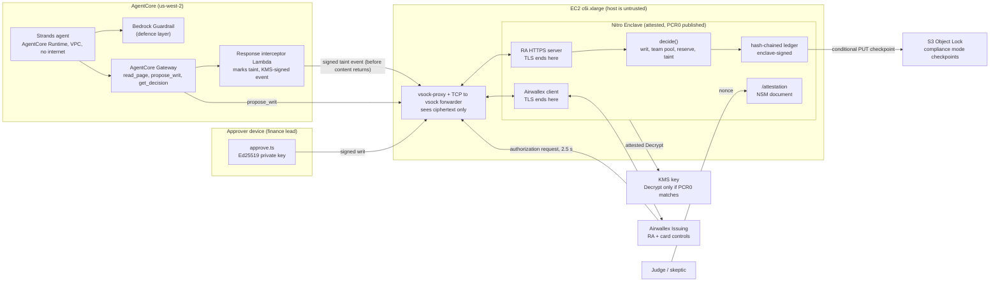

# Writ architecture (AWS + Nitro Enclave design, Nov 9 2026)

Status: design of record from Mon Nov 9, 15:30 IST. Supersedes the "server holds the Airwallex key" posture in older files. Every external fact here has a source in section 10. Anything marked VERIFY must be proven by a test or a fixture before the README claims it.

## 1. The one claim, upgraded
1. Old claim: "no agent can spend past the approved task, the team budget or the cash reserve, even after it has been tricked."
2. New claim, same harm, same mechanism, sharper proof: "No agent, and nobody with root on the server, can make a Writ card spend outside a task a human signed. The only code that can say yes is the code whose hash we published, and AWS signs a document that proves it."
3. One harm: a finance lead finds an agent spent money nobody approved.
4. One mechanism: decide() at the card authorization, running inside an attested Nitro Enclave.
5. One track: kit 2, card issuing.
6. Why this is not a Postgres feature: the key that can arm a card or answer Remote Authorization (RA) only decrypts inside an enclave whose image hash (PCR0) matches a KMS key policy. Plain Postgres plus an API server cannot give a third party that proof.

## 2. What closes the old trust hole
1. Old hole: the Writ server held the Airwallex API key and the RA shared secret. Anyone with root on that box could arm a card, or answer AUTHORIZED to any swipe, and no one outside could tell.
2. Fix part 1: the Airwallex API key is stored only as KMS ciphertext. The KMS key policy allows Decrypt only when the request carries a Nitro attestation document whose PCR0 (`kms:RecipientAttestation:ImageSha384`) equals the published Writ enclave image hash. The host role alone gets AccessDenied.
3. Fix part 2: the RA shared secret is created inside the enclave. On boot the enclave itself calls `POST /api/v1/issuing/config/update` with `new_shared_secret: true` over TLS that ends inside the enclave. The secret is returned once, into enclave memory, and never touches the host.
4. Fix part 3: approvals are Ed25519 signatures made on the approver's device. The approver public keys are baked into the enclave image, so they are part of PCR0. Changing who can approve changes the hash.
5. Fix part 4: every decision goes into a hash chain signed by an enclave key. Checkpoints go to an S3 bucket with Object Lock in compliance mode, so nobody can rewrite history before retention ends, not even the AWS root user.
6. What it does NOT fix (say this out loud, a skeptic will ask):
   - The Airwallex account owner can still log in to the Airwallex dashboard, make a new API key, or change a card. Writ protects the running system, not the Airwallex login. Airwallex logs those dashboard actions.
   - A human pastes the Airwallex API key once to seal it (`scripts/seal-secret.ts` on the Mac: KMS Encrypt, then wipe). For those seconds it is plaintext on one laptop.
   - The AWS account admin can make a new KMS key and a new enclave image. That changes PCR0, which shows up in every attestation document, so it is detectable, not impossible.

## 3. Components
1. Approver device (Shubham's Mac in the demo, labelled "finance lead"): holds the Ed25519 approver private key in `~/.writ/`. Runs `scripts/approve.ts` to sign a writ hash. Never sees the Airwallex key.
2. Agent: a Strands agent on Amazon Bedrock AgentCore Runtime in us-west-2, model on Bedrock. Network mode VPC with private subnets and no route to the internet. Its only tools are behind AgentCore Gateway: `read_page(url)`, `propose_writ(...)`, `get_decision(writ_id)`. It has no card number, no Airwallex key, and no route to the enclave.
3. AgentCore Gateway: typed MCP tools. A RESPONSE interceptor Lambda on `read_page` is the taint marker (section 6). A Bedrock Guardrail sits on the agent's model calls as a defence layer only (section 6.5).
4. Enclave host: one always-on EC2 instance in us-west-2, `c6i.xlarge` (4 vCPU, 8 GiB), Amazon Linux 2023, Nitro Enclaves enabled. Gives the enclave 2 vCPU and about 3 GiB. Runs only dumb forwarders: `vsock-proxy` (outbound, allowlisted hosts) and a TCP to vsock forwarder (inbound). It holds ciphertext and an IAM role, nothing else of value. Elastic IP for a stable RA URL.
5. Writ enclave (EIF built from `enclave/Dockerfile`): Bun runtime plus:
   - `decide()` and the ledger (the same TypeScript as plain mode, SQLite in memory).
   - RA HTTPS server: TLS terminates inside the enclave with a key generated inside it (section 5.3).
   - Airwallex client: outbound TLS to `api.sandbox.airwallex.com` through vsock-proxy. The host only forwards encrypted bytes.
   - `kmstool_enclave_cli` (AWS Nitro Enclaves SDK) for attested KMS Decrypt and GenerateDataKey.
   - `libnsm` (aws-nitro-enclaves-nsm-api) called through `bun:ffi` for attestation documents with our own `user_data` and a caller nonce. VERIFY the C function signature before relying on it; fallback is a 40 line Rust helper on the same crate.
   - `socat` for the vsock bridges.
6. KMS: one symmetric key `writ-demo` with an attestation-pinned policy (section 5.1). One ECC_NIST_P256 SIGN key `writ-taint-signer` usable only by the interceptor Lambda role.
7. S3 bucket `writ-ledger-<account>`: versioning on, Object Lock compliance mode, default retention 30 days, RemovalPolicy RETAIN. Holds signed checkpoints and the sealed state blob.
8. Secrets Manager: holds only the KMS ciphertext of the Airwallex API key (`writ/airwallex/api-key.kms`). Read by the host role, useless without an attested enclave.
9. AWS Budgets: alerts at US$100, US$300 and US$1,000 actual, plus a forecast alert. CloudTrail on, so every KMS Decrypt shows the ImageSha384 it was granted for.
10. Console: the same five panel Bun page as before, now with a sixth strip: "Decided by enclave PCR0 abc123..., attestation verified".

## 4. Diagram

## 5. How each piece works

### 5.1 Key sealing (KMS + attestation)
1. KMS key policy statements (CDK writes them, PCR0 is a deploy parameter):
   - Allow `kms:Encrypt` to the operator role (so a human can seal a secret). Encrypt does not need attestation.
   - Allow `kms:Decrypt` and `kms:GenerateDataKey` to the EC2 instance role only with `StringEqualsIgnoreCase` on `kms:RecipientAttestation:ImageSha384` = published PCR0.
   - No statement grants Decrypt without that condition.
2. Two keys:
   - `writ-dev`: policy is mutable, used while iterating, since every EIF rebuild changes PCR0.
   - `writ-demo`: created once the demo image is frozen. Its policy grants nobody `kms:PutKeyPolicy` (created with BypassPolicyLockoutSafetyCheck). After that, nobody in the account can widen it. Recovery would need AWS Support. Say this in the README and show the policy JSON.
3. Debug mode: an enclave started with `--debug-mode` reports zeroed PCRs, so KMS refuses it. That is how we prove "you can't read memory and still decrypt". Never run the demo enclave in debug mode.
4. Credentials: the host passes the instance role's temporary credentials into the enclave over vsock for KMS and S3 calls. Stealing them gives the host nothing, because KMS still demands the attestation and S3 objects are signed by the enclave.

### 5.2 Approvals
1. A writ is canonical JSON of: id, team, agent, purpose, merchantName, mcc, amountMinor, currency, approvedAt, expiresAt, nonce. hash = sha256 hex. Signature = Ed25519 over the hash, made on the approver device.
2. Approver public keys live in `enclave/config/approvers.json`, copied into the image. They are part of PCR0.
3. The enclave verifies signature, hash, expiry, single use, then reserves pool money. The host relays the signed writ and can only drop it.
4. WebAuthn passkeys are cut for time. Ed25519 on the device gives the same property for the demo. Say so.

### 5.3 Inbound RA and why TLS must end inside the enclave
1. The RA signature is `base64(HMAC_SHA256(secret, x-nonce))`. It covers the nonce only, not the body (docs/AIRWALLEX_API.md section 5).
2. So if TLS ended on the host (ALB, nginx, or ACM for Nitro Enclaves, which runs nginx on the parent and only keeps the private key in an enclave), root on the host could keep a valid nonce and signature and rewrite the body: a $1,999 swipe at an unknown merchant becomes a $180 swipe at DataCo, the enclave says AUTHORIZED, and Airwallex approves the real $1,999. That is a full bypass. ACM for Nitro Enclaves does not solve it.
3. Design: the host forwards raw TCP 443 (and 80 for ACME) to vsock. The enclave runs the TLS server. Its TLS key is generated inside the enclave and never leaves.
4. Certificate: Let's Encrypt IP address certificate for the Elastic IP (GA since Jan 15 2026, `shortlived` profile, 160 hours, http-01 or tls-alpn-01). ACME client runs inside the enclave (`lego` with `--profile shortlived`, VERIFY flag name). The cert and key are sealed with the attested data key, so a restart reuses them instead of hitting rate limits. Fallback: a hostname on a domain he controls, same ACME flow.
5. Latency budget inside the 2.5 s window (measure, do not assume):
   - Network and TLS handshake from Airwallex to us-west-2: unknown. Measure p50 and p99 on real RA calls. If Airwallex calls from Asia, one round trip can be 150 to 250 ms and a full TLS 1.3 handshake adds one more.
   - Handler: verify HMAC, map payload, decide() from memory: under 10 ms.
   - Commit before AUTHORIZED (section 5.5): one S3 conditional PUT, timeout 800 ms. Declines do not wait for S3.
   - Total target: under 1.2 s at p99. If p99 is over 1.5 s, move the enclave host to the region nearest Airwallex's caller (likely ap-southeast-1 or ap-southeast-2) and keep AgentCore in us-west-2.
6. Freshness: nonce within 30 s of the enclave clock, nonce replay cache, constant time compare.
7. Enclave clock: Nitro Enclaves take time from the KVM clock at boot and can drift. The enclave tracks the offset against the `Date` header on its TLS-verified Airwallex responses (refreshed every 10 s with the balance poll), so the host cannot fake time. VERIFY `/dev/ptp0` with chrony as a better source if present.

### 5.4 Outbound calls
1. vsock-proxy on the host with an allowlist: `api.sandbox.airwallex.com:443`, `kms.us-west-2.amazonaws.com:443`, `s3.us-west-2.amazonaws.com:443` (or the bucket host), `acme-v02.api.letsencrypt.org:443`.
2. Inside the enclave, socat listens on 127.0.0.1 ports and connects to vsock CID 3. `/etc/hosts` maps the hostnames to 127.0.0.1 so TLS hostname checks still pass.
3. The enclave never trusts a response it did not get over its own TLS session.

### 5.5 Ledger, persistence and rollback
1. The enclave has no disk. State lives in memory (bun:sqlite `:memory:`, same schema as plain mode).
2. Every event (proposal, approval, decision, arm, disarm, RA request, clearing, reversal, taint, alert) is appended as:
   `entry_n = {seq: n, prev: h_(n-1), at, kind, payload}`, `h_n = sha256(canonical(entry_n))`, `sig_n = Ed25519(enclave_ledger_key, h_n)`.
3. Enclave ledger key: generated inside the enclave on first boot. Its private half is sealed with an attested KMS data key (GenerateDataKey with Recipient). Its public half goes into the `user_data` of every attestation document, so a judge can tie ledger signatures to PCR0.
4. The host gets each signed entry over vsock and appends it to `/var/lib/writ/ledger.jsonl`. The host can drop or reorder, but cannot forge an entry.
5. Commit rule: before replying AUTHORIZED (RA) or before arming a card (frozen), the enclave writes `checkpoints/<seq, 12 digits>.json` = {seq, head hash, sig, sealed state blob id} to S3 with `If-None-Match: *` and a checksum header (Object Lock requires one). If the PUT fails or times out, the answer is DECLINED with COMMIT_FAILED. This makes a writ's consumption durable before money can move.
6. Reload: the enclave unseals its keys, lists `checkpoints/` over its own TLS session to S3, takes the highest seq with a valid enclave signature, then asks the host for the ledger file. It verifies every entry and signature from genesis and checks the head matches the checkpoint. A short, edited or reordered file means STATE_UNVERIFIED: every swipe declines until fixed.
7. Fork check: if any checkpoint key has more than one version, or a delete marker, someone ran two copies or tampered. The enclave halts and declines everything. The host role has an explicit deny on `s3:DeleteObject*` and `s3:PutObjectRetention`.
8. After a restart, before answering any swipe, the enclave reads Airwallex card transactions since the last checkpoint and replays them into the ledger (clearings, reversals, forced captures).
9. Object Lock compliance retention is 30 days. The bucket outlives `cdk destroy` and costs cents. Say that in the teardown notes.

### 5.6 Attestation endpoint
1. `GET /attestation?nonce=<hex>` returns the NSM attestation document (CBOR, COSE_Sign1) with `nonce` echoed and `user_data` = sha256 of {ledger public key, approver keys hash, taint signer key, RA URL, rung}.
2. `scripts/verify-attestation.ts` (runs anywhere, no AWS creds): checks the COSE signature chain to the AWS Nitro root certificate, checks the nonce, prints PCR0, PCR1, PCR2 and compares PCR0 to `enclave/PCR0.txt` in the repo commit being judged.
3. Reproducibility: PCR0 depends on the exact image bytes. We publish the Dockerfile with every base image pinned by digest, the EIF build log and PCR0. A byte-for-byte rebuild by a judge is a stretch goal; do not claim it unless `make eif` twice on two machines gives the same PCR0.

## 6. Taint, Guardrail and the agent

### 6.1 Agent
1. Strands agent (Python, `agent/`) on AgentCore Runtime, Bedrock model in us-west-2. Test model access on day 1; new accounts may not get the newest Claude models. Fallback model: whatever Bedrock grants, or Strands AnthropicModel with the key in Secrets Manager (Will Laws, Slack Nov 9).
2. Runtime network mode VPC, private subnets, no NAT. VPC endpoints for Bedrock runtime, ECR, CloudWatch Logs, S3 and the AgentCore Gateway data plane. VERIFY that a Gateway interface endpoint exists. If not: NAT plus AWS Network Firewall with a domain allowlist of the Gateway host only.
3. Each agent has its own Gateway identity (Cognito client or JWT). The interceptor maps the identity to the agent's card. The agent cannot pick its card id.

### 6.2 Taint marker
1. `read_page(url)` is a Gateway target (Lambda) that fetches the page.
2. A RESPONSE interceptor Lambda runs before the result goes back to the agent. If the URL host is not on the allowlist, it builds `{agent, url_sha256, at, seq}`, signs it with the KMS SIGN key `writ-taint-signer`, and POSTs it to the enclave.
3. The interceptor waits for the enclave's signed ack. Only then does it return the page to the agent. No ack in 1 s: the tool returns an error, the agent never sees the content.
4. Result: the agent can't hide what it read, because it never reported it. The enclave learns "tainted" before the agent learns the text.
5. On taint the enclave marks the agent tainted from that time and, in frozen mode, disarms the card at once.

### 6.3 What the taint marker can't do
1. The interceptor Lambda is operator code, not attested. An admin who removes it removes taint. Then the writ still binds amount, merchant, MCC, currency and expiry, so damage is capped by what a human signed. Taint is a defence. The writ is the boundary.

### 6.4 Policy in AgentCore (optional)
1. A Cedar policy on the Gateway can refuse `propose_writ` over a size. Nice to have, operator editable, not a boundary. Cut unless all else is done.

### 6.5 Bedrock Guardrail: defence layer, not the boundary
1. It is a classifier on text. It gives a score, not a proof, and prompt injection is designed to look harmless.
2. It sees words, not money. It does not know the team pool, the cash reserve or what a human approved.
3. It sits in the model call path, which the operator configures and can turn off. It is not attested.
4. A miss costs real money, so a probabilistic filter can't be the last check.
5. So: Guardrail cuts noise (fewer bad proposals reach a human). decide() in the enclave is the only thing that says yes.

## 7. Trust table
| Actor or part | Can do | Cannot do | Why |
|---|---|---|---|
| Agent (model) | Read pages through the Gateway, propose a writ, read decisions | See a card number, hold any key, reach the enclave or Airwallex, approve, hide a taint | No network but the Gateway; taint is marked by the interceptor before content returns |
| Prompt injection in a page | Make the agent propose bad things | Make anything spend outside a signed writ | decide() binds every yes to a signed hash |
| Approver device | Sign a specific writ | Change the pool, the reserve or the enclave code | Signature covers one hash; rules live in the measured image |
| Root on the EC2 host | Drop, delay or reorder traffic; stop the enclave (all swipes then decline) | Read the Airwallex key or RA secret, forge an approval, rewrite an RA body, forge a ledger entry, roll back state | KMS needs PCR0 attestation; TLS ends in the enclave; ledger is enclave-signed with S3 Object Lock checkpoints |
| AWS account admin | Deploy a new image, make a new KMS key, remove the taint interceptor | Do any of that invisibly; widen `writ-demo` policy; delete locked checkpoints before 30 days | New code means new PCR0 in every attestation; locked key policy; Object Lock compliance |
| Interceptor Lambda | Sign taint events | Approve spend | Its KMS key is SIGN only; the enclave only accepts taint from it |
| Bedrock Guardrail | Block some bad model output | Guarantee anything | Probabilistic, not attested |
| Airwallex | Approve or decline at the network, apply its own risk checks, call RA | n/a | Issuer of record; may decline after we approve |
| Airwallex account owner (dashboard) | Make a new API key, change cards, repoint RA | Hide it from Airwallex logs | Out of Writ's scope; stated in limits |
| Judge | Send a nonce, get an attestation, check PCR0 against the repo, read CloudTrail screenshots | n/a | `scripts/verify-attestation.ts` |

## 8. Fallback ladder (cut times IST)
Build bottom up. Each rung reuses the same decide(), ledger and adapter. Only the host and the Airwallex mode change. Each rung must demo end to end.

| Rung | Name | What runs | Cut time to reach it | Claims that hold | Claims that die |
|---|---|---|---|---|---|
| R4 | Plain + frozen | Bun on the Mac, frozen-card arming | Must pass by Tue Nov 10, 14:00 | Writ binds amount, MCC, merchant, expiry; team pool; reserve; taint disarms; Airwallex refuses off-writ swipes | Swipe time decision, attestation, "root can't approve", secret isolation. README says the server holds the Airwallex key |
| R3 | Plain + RA | Bun on the EC2 host (no enclave) or Mac plus tunnel, RA on | Wed Nov 11, 14:00 (needs Turner's enablement) | All of R4 plus "Airwallex asks Writ at each swipe", fail closed on timeout | Attestation, "root can't approve", secret isolation |
| R2 | Enclave + frozen | Enclave arms and disarms cards over outbound vsock. No inbound TLS needed: approvals, taint events and attestation documents are signed, so the host relays them as plain bytes | Go/no-go Wed Nov 11, 22:00 | All of R4 plus: only attested code can arm a card; host root can't read the key, forge an approval or rewrite the ledger; attestation proves PCR0 | Swipe time decision |
| R1 | Enclave + RA | Enclave answers RA with TLS inside it | Go/no-go Thu Nov 12, 14:00 | Everything in section 7 | None, if p99 under 1.5 s and simulated swipes reach RA |

Rules:
1. Default if the enclave is not working by Wed Nov 11, 22:00 IST: ship R3 if RA works by then, else R4. Stop enclave work, keep the code on a branch, and either drop all enclave claims or say "designed and partly built" in one honest line.
2. "Working" for R2 means: the demo EIF (not debug mode) unseals the Airwallex key via attested KMS, arms one sandbox card for one signed writ, a host-root forge attempt fails, and `verify-attestation.ts` passes. All four, twice.
3. "Working" for R1 means R2 plus: a simulated swipe reaches the enclave, the transaction's `remote_auth.default_action_used` is false with our status_reason, p99 under 1.5 s over 20 swipes.
4. RA probe gate (from D1): if simulated swipes never reach any RA endpoint, R1 and R3 are both dead. Then R2 is the top rung.
5. Pitch wording per rung lives in docs/DEMO_SCRIPT.md. Never say "decided at swipe time" below R3. Never say "even root can't" below R2.

## 9. Why not the obvious alternatives
1. Official AWS kit pattern (awx-devx/airwallex-agentic-banking-aws): the adapter Lambda holds the Airwallex secret. Whoever can update that Lambda can spend. Writ moves the key into attested code.
2. AgentCore payments (GA Aug 2026): x402 and stablecoin micro payments for paid APIs with per session limits. No corporate card, no team pool across agents, no cash reserve, no human-signed task.
3. Per card limits alone: per card. The budget is per team and the cash is per company.
4. A Lambda RA endpoint: cold starts can miss the window (Will Laws). We use an always-on instance.

## 10. Sources (checked Mon Nov 9 2026)
1. Nitro Enclaves requirements, supported instance types (c6i except c6i.large and metal), all Regions, no extra charge: https://docs.aws.amazon.com/enclaves/latest/user/nitro-enclave.html
2. KMS condition keys `kms:RecipientAttestation:ImageSha384` (= PCR0) and `PCR<n>`, effective only with a Recipient attestation: https://docs.aws.amazon.com/kms/latest/developerguide/conditions-nitro-enclave.html
3. Enclave plus KMS getting started, PCR0 policy template: https://docs.aws.amazon.com/enclaves/latest/user/connect-enclave-kms.html and https://docs.aws.amazon.com/enclaves/latest/user/kms.html
4. vsock-proxy allowlist config: https://github.com/aws/aws-nitro-enclaves-cli/blob/main/vsock_proxy/README.md
5. Inbound HTTPS into an enclave with TLS ending inside (AWS Web3 blog): https://aws.amazon.com/blogs/web3/aws-nitro-enclaves-for-running-ethereum-validators-part-2/
6. ACM for Nitro Enclaves runs nginx or httpd on the parent, RSA only: https://docs.aws.amazon.com/enclaves/latest/user/nitro-enclave-refapp.html
7. Let's Encrypt IP address and 6 day certs GA Jan 15 2026: https://letsencrypt.org/2026/01/15/6day-and-ip-general-availability and profiles https://letsencrypt.org/docs/profiles/
8. Enclave clock drift and /dev/ptp0: https://evervault.com/blog/how-we-built-enclaves-resolving-clock-drift-in-nitro-enclaves and https://github.com/aws/aws-nitro-enclaves-cli/issues/500
9. S3 Object Lock (compliance mode, root can't delete, versioning required): https://docs.aws.amazon.com/AmazonS3/latest/userguide/object-lock.html
10. S3 conditional writes with If-None-Match, behaviour in versioned buckets: https://docs.aws.amazon.com/AmazonS3/latest/userguide/conditional-writes.html
11. AgentCore Regions (Runtime, Gateway, Policy in us-west-2): https://docs.aws.amazon.com/bedrock-agentcore/latest/devguide/agentcore-regions.html
12. AgentCore Gateway interceptors: https://docs.aws.amazon.com/bedrock-agentcore/latest/devguide/gateway-interceptors.html
13. AgentCore Runtime VPC mode: https://docs.aws.amazon.com/bedrock-agentcore/latest/devguide/agentcore-vpc.html
14. AgentCore payments GA: https://aws.amazon.com/about-aws/whats-new/2026/08/bedrock-agentcore-payments-ga/
15. Official AWS kits repo: https://github.com/awx-devx/airwallex-agentic-banking-aws
16. Slack, Will Laws (AWS SA), #aws-ask-an-architect, Nov 6 09:15 IST: AgentCore Runtime plus Gateway plus Guardrail, us-west-2, always-on RA endpoint, Secrets Manager, CDK, Budgets. C0CF4HQ7FK2/p1793936715864339
17. Slack, Will Laws, Nov 9 10:47 IST: Bedrock access blocks on some new accounts; AnthropicModel fallback; credits need the Paid plan. C0CF4HQ7FK2/p1794201514180939
18. The designs we copy, and the parts of those designs we refuse: docs/REFERENCES.md. Trail of Bits on Nitro, Evervault Cages, RFC 6962 and immudb for the chain, Airwallex plus Marqeta for the swipe.
